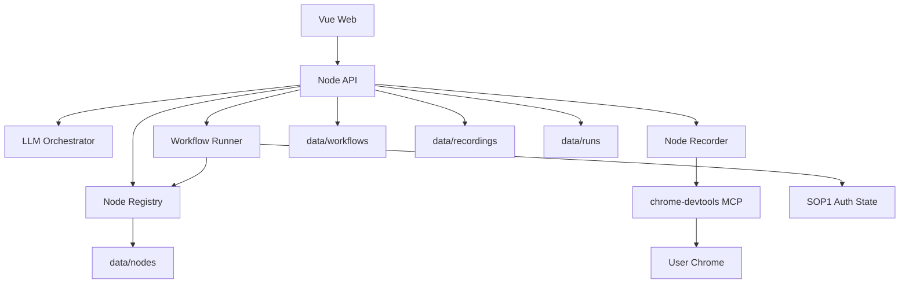

# 阶段二技术方案总览：LLM 编排 + 节点共建平台

> 文档版本：v1.1  
> 更新时间：2026-05-15  
> 文档定位：阶段二技术入口索引与稳定架构摘要  
> 详细信源：`docs/architecture/`  
> ADR：`docs/decisions/`

---

## 1. 文档定位

阶段二技术方案已拆分为模块级文档。本文件只保留总体架构、关键决策和模块索引。

---

## 2. 架构原则

1. 设计期与执行期分离：LLM 只负责生成 workflow 和提取接口规范草稿。
2. 后端是 MCP Client：LLM 不是 MCP Client，只消费后端整理后的请求证据。
3. 录制证据优先：接口规范必须来自真实 Network 请求和完整 response body。
4. 确定性转换：LLM 输出 `ApiCaptureSpec`，平台转换为 `NodeDefinition`。
5. 执行期无 mock：runner 只执行已注册 handler 或草稿 NodeDefinition。
6. 鉴权复用 SOP1：所有录制节点试调用和 workflow 执行复用同一份本地登录态。

---

## 3. 总体架构

---

## 4. 模块索引

| 模块 | 文档 |
|---|---|
| 总体架构 | [system-overview.md](system-overview.md) |
| 前端 | [frontend.md](frontend.md) |
| 后端 API | [backend-api.md](backend-api.md) |
| Workflow Runner | [workflow-runner.md](workflow-runner.md) |
| Node Registry | [node-registry.md](node-registry.md) |
| Node Recorder | [node-recorder.md](node-recorder.md) |
| LLM Orchestrator | [llm-orchestrator.md](llm-orchestrator.md) |
| 鉴权底座 | [auth-state.md](auth-state.md) |
| 数据存储 | [data-storage.md](data-storage.md) |
| 测试策略 | [testing.md](testing.md) |

---

## 5. 关键 ADR

- [ADR-001：禁止 mock fallback 伪造成功](../decisions/ADR-001-no-mock-fallback.md)
- [ADR-002：LLM 不是 MCP Client](../decisions/ADR-002-llm-not-mcp-client.md)
- [ADR-003：先生成 ApiCaptureSpec，再转换 NodeDefinition](../decisions/ADR-003-api-capture-spec-before-node-definition.md)
- [ADR-004：支持 recorded_http_flow 多接口录制节点](../decisions/ADR-004-recorded-http-flow.md)
- [ADR-005：MCP responseFilePath 是完整响应体主证据](../decisions/ADR-005-mcp-response-filepath.md)
- [ADR-006：一期证明核心主张，二期评估成熟平台底座](../decisions/ADR-006-fastgpt-second-phase.md)

