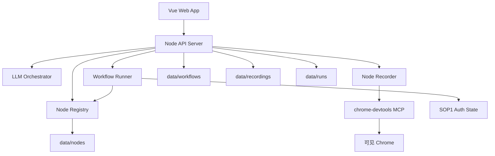

# 系统总览

## 1. 总体架构



## 2. 模块职责

| 模块 | 职责 | 不负责 |
|---|---|---|
| Web | 页面、表单、卡片视图、录制向导、试运行交互 | 业务请求执行、LLM 调用 |
| API | 路由、文件读写、模块编排、错误结构化 | 业务规则硬编码 |
| LLM Orchestrator | workflow 生成、ApiCaptureSpec 生成、trace 脱敏落盘 | 控制浏览器、执行节点 |
| Node Recorder | 作为 MCP Client 控制浏览器和采集 Network | 推断业务字段、伪造响应 |
| Node Registry | 加载节点定义、按 type 查找 handler | 执行 workflow |
| Workflow Runner | 解析 YAML、依赖执行、插值、handler 调用、运行日志 | 调用 LLM |
| Auth Base | 复用 SOP1 登录态、判断鉴权失效 | 管理账号密码 |
| Storage | 文件系统持久化 | 数据库事务、多租户隔离 |

## 3. 关键数据流

### 3.1 录制节点

```text
Web Step 1/2
  -> POST /api/nodes/record/start
  -> Recorder.startSession()
  -> MCP open/select page
  -> 用户操作 Chrome
  -> GET /api/nodes/record/:id/status 轮询请求数
  -> POST /api/nodes/record/finish
  -> Recorder.listCapturedRequests()
  -> filterCapturedRequests()
  -> LLM.extractApiCaptureSpec()
  -> convert ApiCaptureSpec to NodeDefinition
  -> validate NodeDefinition
  -> Web Step 3 展示草稿
  -> invoke draft / register node
```

### 3.2 新建工作流

```text
用户自然语言
  -> POST /api/workflows/generate
  -> 注入 availableNodes
  -> LLM.generateWorkflow()
  -> parse/validate workflow
  -> Web 卡片预览
  -> run draft
  -> save workflow
```

### 3.3 运行 workflow

```text
workflow YAML + inputs
  -> parseWorkflow
  -> validateWorkflow
  -> buildExecutionPlan
  -> for each batch:
       resolve inputs
       check when
       run handler
       collect outputs/logs
  -> render workflow outputs
  -> persist run result/log
```

## 4. 稳定架构原则

- LLM 不是 MCP Client。
- Node Recorder 不调用业务规则。
- Workflow Runner 不调用 LLM。
- NodeDefinition 不保存鉴权字段。
- 真实依赖缺失必须失败。
- 录制证据、LLM trace、转换结果和运行日志必须可追溯。

## 5. 主要目录

| 目录 | 说明 |
|---|---|
| `apps/web` | Vue 前端 |
| `apps/api` | Node API |
| `packages/llm-orchestrator` | LLM prompt、adapter、schema |
| `packages/workflow-runner` | runner、registry、handlers、validator |
| `packages/node-recorder` | MCP recorder、filter、转换 |
| `packages/shared` | 共享类型 |
| `data` | workflow、node、recording、run 文件 |
| `secrets` | 本地登录态 |
