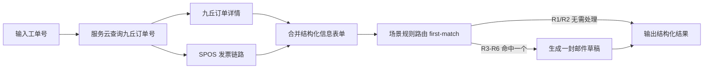

### 问题 16：新建工作流能力规划与规则分支抽象

**问题描述**：

当前“新建工作流”已能通过自然语言调用 LLM 返回 YAML 源码，但距离可稳定联调的“生成 → 预览 → 试运行 → 保存 → 使用”闭环仍有明显断点。用户本次给出的直客订单 case 中，LLM 返回的 YAML 使用了 `workflow:` 根节点、`config`、`output`、camelCase 字段名和正文中的裸 `$xxx` 引用；这些与当前 runner 实际可执行 schema 不一致，导致后续卡片视图、试运行、保存使用都缺少可靠前提。

同时，SOP1 中后续场景判断和不同场景处理不应按 case 硬编码。更合适的方向是抽象为通用能力：规则判断、条件执行、邮件草稿、结构化输出。该主题用于先规划和对齐，不立即进入实现。

**当前态**：

- 新建页可以输入自然语言需求，调用 `/api/workflows/generate` 并流式返回 YAML。
- LLM prompt 目前只列出节点 `type/name/description`，没有给出严格可执行 YAML 模板、字段映射示例、输出约束和反例。
- 当前实际 workflow schema 期望顶层字段为 `id/name/description/inputs/nodes/outputs`，不支持 `workflow:` 包裹层。
- 当前 runner 只按 `nodes` 顺序执行；`WorkflowNode` 类型里有 `when/then`，但 runner 尚未执行条件分支逻辑。
- 当前引用能力支持：
  - 独立值：`$inputs.field`、`$nodeId.field`
  - 文本模板：`{{ inputs.field }}`、`{{ $inputs.field }}`、`{{ steps.nodeId.field }}`、`{{ $nodeId.field }}`
  - 多行邮件正文中直接写 `$inputs.xxx` 不会被替换，必须使用 `{{ ... }}` 模板。
- 当前直客订单相关录制节点实际字段为：
  - `serviceforce.query_customer_order_no` 输入：`soid`；输出：`jiuqiu_order_no`
  - `jiuqiu.query_order_detail` 输入：`order_no`；输出：`order_status`、`service_products[]`
  - `spos.query_b2c_order` 输入：`platform_order_code`；输出：`order_items[]`
  - `mail.draft` 输入：`to[]/cc[]/subject/template`；输出：`draft`
- 预览页已有基础节点卡片展示，但依赖前端 YAML parser 能解析出当前 schema；当 LLM 生成非标准 YAML 时无法形成可靠卡片视图。
- 预览页“试运行”目前跳到 `/workflows/{id}/run?trial=1`，但未保存草稿没有落到 `data/workflows`，后端无法通过 id 读取草稿 workflow，因此草稿试运行链路不闭环。
- 通用运行页已有输入入口、节点进度、日志、最终 `genericResult` 展示；但没有明确展示“每个节点的输出快照”。
- “让 AI 改一下”已有入口概念，但对未保存草稿的上下文传递不完整；可作为轻量能力保留，不做复杂工程化。
- 保存并使用已有 `/api/workflows` POST/PUT 和“我的工作流”列表，但需要在保存前完成强校验，否则会保存不可运行 YAML。
- `rules.evaluate` 已存在，但能力较弱：只支持简单 `==`、`!=`、`&&` 判断，且没有 runner 级条件跳过机制。

**期望态（已确认边界）**：

第一阶段先做“新建工作流最小闭环”，目标不是追平主流工作流平台，而是让 demo 原型真实可用：

- 自然语言生成的 YAML 必须直接符合当前 runner 可执行 schema。
- 生成结果默认展示为卡片视图，并可切换查看 YAML。
- 预览阶段必须显示 schema 校验结果、节点是否存在、节点输入字段是否匹配、引用是否能解析到前序节点或 inputs。
- 试运行支持未保存草稿：用户填写 workflow inputs 后执行草稿 YAML，展示每个节点的输入、输出、状态和最终 outputs。
- “让 AI 改一下”先做轻量链路：传入当前 YAML + 用户修改要求，让 LLM 返回新的 YAML，不引入复杂版本管理、diff 编辑器或多人协作。
- 保存并使用只允许保存通过后端强校验的 workflow，并进入“我的流程”列表。
- 规则判断与邮件草稿作为通用能力接入，而不是 SOP1 case 专用逻辑。

已确认边界（2026-05-15 根据试运行反馈待修正）：

- 暂不做拖拽式画布、复杂 DAG 编辑、循环、人工审批节点、复杂表达式语言。
- 不再把“并行”整体排除；第一版需要支持简单串行/并行组合：线性顺序仍是默认形态，允许少量节点通过显式依赖形成并行批次，但不提供拖拽画布、任意连线或复杂 DAG 编辑体验。
- 暂不做 by case 的 SOP1 特判；SOP1 的“不同场景不同处理”只作为规则/条件/邮件草稿能力的验证样例。
- 允许使用一个固定的“可执行 YAML 模板示例”放进 LLM system prompt，作为 few-shot 示例，以换取生成稳定性。
- 规则能力第一版覆盖 `==`、`!=`、`&&`、数组非空、字段为空/非空，以及邮件草稿条件生成。

**分析与解决**：

建议拆成两个层级推进。

#### A. 新建工作流 MVP 闭环

1. 统一可执行 YAML 规范
   - 明确顶层只允许 `id/name/description/inputs/nodes/outputs`。
   - 禁止 `workflow:` 包裹、`config`、`output` 单数、未注册 node type。
   - 明确字段名必须使用节点定义中的真实 input/output name，例如 `soid`、`order_no`、`platform_order_code`。
   - 明确邮件正文模板必须使用 `{{ ... }}`。

2. 加强 LLM 生成 prompt
   - 将可用节点从简单表格升级为结构化摘要：type、name、description、inputs、outputs。
   - 给出一份和当前 runner 完全一致的 YAML 模板。
   - 针对直客订单 case 给出非硬编码的 few-shot：展示如何串联节点字段，但不写固定业务兜底。
   - 明确“不输出 Markdown 代码块，只输出 YAML 正文”，避免前端/后端解析前还要剥离 ```yaml。

3. 后端增加 workflow 草稿校验能力
   - 在保存前复用 `parseWorkflow` + `validateWorkflow`。
   - 增加更细校验：节点输入字段是否存在、必填 input 是否已配置、引用的 `$nodeId.field` 是否来自前序节点 outputs、`outputs` 引用是否可解析。
   - 前端预览页展示校验错误，而不是只判断 `id + nodes.length`。

4. 卡片视图
   - 以解析后的 workflow nodes 为主，展示节点名、平台、输入映射、输出字段、引用来源。
   - 对无法解析或字段不匹配的节点显示错误态。
   - 允许切换 YAML 源码，但卡片视图作为默认视图。

5. 草稿试运行
   - 新增“运行草稿 workflow”接口，输入 `{ yaml, inputs }`，不要求先保存。
   - 后端执行后返回 RunRecord，保留每个节点完成日志中的 `data`。
   - 前端展示 input 表单、节点级输出快照、最终 outputs。
   - 草稿试运行可选择不持久化，或持久化到临时 runs 目录；先建议不写入正式“我的流程”。

6. 保存并使用
   - 保存前必须通过后端强校验。
   - 保存后写入 `data/workflows/{id}.yaml` 和 `{id}.meta.json`。
   - 保存成功后进入运行页或我的流程列表。

7. 让 AI 改一下
   - 第一版只传：当前 YAML、用户修改说明、同一份节点能力摘要。
   - 返回新 YAML 后复用同一套校验和预览。
   - 不引入复杂 diff 合并；用户通过预览确认。

#### B. 规则判断与场景处理抽象

SOP1 的后续场景判断可以做，但不建议在新建工作流里写 case 特判。建议抽象为通用能力：

当前能力评估：

| 能力项 | 当前是否支持 | 判断 |
|---|---|---|
| `==` / `!=` | 部分支持 | `rules.evaluate` 已支持简单比较，但只会在自身 inputs 上按字段名取值，尚不适合表达跨节点 facts。 |
| `&&` | 部分支持 | 已支持按 `&&` 拆分多条件，但没有括号、`||`、优先级；第一版边界内可以继续保持简单。 |
| 数组非空 | 不支持 | 当前规则没有 `notEmpty()` / `empty()` 或数组长度判断。 |
| 字段为空/非空 | 不支持 | 当前只能和字符串或 `null` 做等值比较，缺少统一空值语义。 |
| 邮件草稿条件生成 | 不支持完整链路 | `mail.draft` 可生成草稿，但 runner 不支持 `when`，无法根据规则结果跳过或执行邮件节点。 |
| SOP1 场景处理抽象 | 不支持完整链路 | 可以作为验收样例，但需要先补通用 rules facts、空值判断和 `when`。 |

因此第一版需要新增/增强的是通用规则能力，而不是 SOP1 专用规则。建议能力形态如下：

```yaml
- id: rule_need_invoice_mail
  type: rules.evaluate
  inputs:
    facts:
      order_status: $jq_detail.order_status
      order_items: $spos_info.order_items
    expression: "order_status == 3 && notEmpty(order_items)"

- id: mail_invoice_notice
  type: mail.draft
  when: $rule_need_invoice_mail.passed
  inputs:
    to: []
    cc: []
    subject: 直客订单开票异常提醒
    template: |
      工单号：{{ inputs.work_order_no }}
      九丘订单号：{{ sf_query.jiuqiu_order_no }}
```

这里的 `order_status == 3 && notEmpty(order_items)` 只是用 SOP1 字段做验证样例；runner、rules、mail 都不认识 SOP1 业务，只认识 facts、expression、when 和模板。

1. runner 支持 `when`
   - 节点级 `when` 表达式为 true 才执行。
   - 未执行节点状态为 skipped，输出为空但可追踪。
   - 表达式第一版只支持引用规则节点结果，例如 `$rule_invoice_missing.passed`。

2. 增强 `rules.evaluate`
   - 输入支持一组 facts 和 expression，而不是只在自身 inputs 里找简单 key。
   - 第一版表达式范围保持很小：`==`、`!=`、`empty()`、`notEmpty()`、`&&`。
   - 数组非空通过 `notEmpty(arrayField)` 表达，字段为空通过 `empty(field)` 表达。
   - 输出建议包含 `{ passed, reason, evaluated }`，方便试运行卡片解释命中原因。
   - 不做通用 JS eval，避免安全和不可控行为。

3. 邮件草稿通用化
   - `mail.draft` 继续只生成草稿，不自动发送。
   - 通过 `when` 控制是否生成。
   - 正文使用模板引用 workflow inputs、节点输出和规则命中原因。

4. 结构化输出
   - `outputs` 支持汇总各节点结果。
   - 对数组型输出先展示原始结构；如需表格化，后续再增加轻量 formatter 节点，不在第一版塞进 runner 特判。

#### C. 本轮试运行反馈后的待对齐方案

本轮测试暴露出两个方向需要调整：试运行界面不应脱离新建工作流的卡片视图；执行模型不能只做严格线性，否则 SOP1 的“先汇总结构化表单，再基于表单判断下一步”无法成立。

1. 试运行预览收敛到卡片视图
   - 新建工作流生成后仍以卡片视图作为主承接界面，不再为草稿试运行单独做一套接近 SOP1 的页面。
   - 卡片视图内直接承载试运行状态：节点卡片显示待运行、运行中、成功、失败、跳过；展开后展示本节点 resolved inputs、outputs、日志摘要。
   - 顶部保留 workflow inputs 表单和“试运行”入口；底部或右侧显示最终结构化 outputs。
   - YAML 源码仍作为切换视图保留；调试结果和校验错误优先映射回节点卡片。
   - 已保存工作流的通用运行页也复用同一套节点卡片/运行快照组件，避免新建预览、试运行、正式运行三套 UI 分叉。

2. 简单串并行执行模型
   - 在 `WorkflowNode` 上增加可选 `dependsOn: string[]`。未声明 `dependsOn` 时保持现有线性语义，兼容旧 YAML；声明后由 runner 按依赖分层执行。
   - runner 将 workflow nodes 编译成执行批次：同一批次内依赖都已满足的节点可并行执行；下一批次等待前一批依赖完成。
   - 第一版只支持无环依赖、节点级依赖和全部成功后继续；暂不做循环、人工审批、复杂错误恢复、复杂 join 策略、画布任意连线。
   - `when` 继续作为节点级条件跳过；如果依赖节点失败则后续节点失败或跳过的策略需要在实现前对齐，建议第一版采用“依赖失败则下游 skipped，并记录原因”。
   - 预览卡片可按执行批次展示为“阶段 1 / 阶段 2 / 阶段 3”，同一阶段内并排展示并行节点。

3. 结构化信息表单作为通用中间产物
   - 增加一个轻量内置节点，建议命名为 `data.compose` 或 `form.compose`，职责只做模板插值和结构化对象组装，不写 SOP1 业务判断。
   - SOP1 case 中先通过服务云得到九丘订单号，再并行查询九丘详情与 SPOS 信息，然后用 compose 节点输出结构化信息表单。
   - 后续 `rules.evaluate` 的 facts 从这个结构化表单读取，而不是散落地直接读多个上游节点，便于卡片视图展示“判断依据”。
   - 邮件草稿、下一步动作等继续通过 `rules.evaluate + when + action node` 组合完成，不在 runner 内硬编码 SOP1 场景。

建议目标 YAML 形态如下，作为方案对齐样例：

```yaml
id: wf_direct_order_invoice_summary
name: 直客订单查询与场景判断
description: 输入工单号，查询订单信息，生成结构化表单，并根据表单判断下一步。
inputs:
  - name: work_order_no
    type: string
    label: 工单号
    required: true
nodes:
  - id: sf_query
    type: serviceforce.query_customer_order_no
    inputs:
      soid: $inputs.work_order_no

  - id: jq_detail
    type: jiuqiu.query_order_detail
    dependsOn: [sf_query]
    inputs:
      order_no: $sf_query.jiuqiu_order_no

  - id: spos_info
    type: spos.query_b2c_order
    dependsOn: [sf_query]
    inputs:
      platform_order_code: $sf_query.jiuqiu_order_no

  - id: order_form
    type: data.compose
    dependsOn: [jq_detail, spos_info]
    inputs:
      value:
        work_order_no: $inputs.work_order_no
        jiuqiu_order_no: $sf_query.jiuqiu_order_no
        order_status: $jq_detail.order_status
        service_products: $jq_detail.service_products
        order_items: $spos_info.order_items

  - id: rule_need_invoice_followup
    type: rules.evaluate
    dependsOn: [order_form]
    inputs:
      facts: $order_form
      expression: "notEmpty(order_items) && order_status != 4"

  - id: mail_followup
    type: mail.draft
    dependsOn: [rule_need_invoice_followup]
    when: $rule_need_invoice_followup.passed
    inputs:
      to: []
      cc: []
      subject: 直客订单后续处理提醒
      template: |
        工单号：{{ order_form.work_order_no }}
        九丘订单号：{{ order_form.jiuqiu_order_no }}
        判断结果：{{ rule_need_invoice_followup.reason }}
outputs:
  order_form: $order_form
  need_invoice_followup: $rule_need_invoice_followup.passed
  mail_draft: $mail_followup.draft
```

该形态的重点不是固化 SOP1，而是抽象出四个通用能力：依赖分层执行、结构化表单组装、基于表单的规则判断、条件动作执行。

#### D. 2026-05-15 计划对齐版

结合用户本轮确认，计划收敛为“最低满足 SOP1，但体现通用工作流理念”的 demo 方案，可轻量参考 FastGPT、n8n 等开源工作流平台的常见交互：节点、关系线、运行状态、节点输入输出追踪；不追求完整平台能力。

1. 支持串行和简单并行，并在前端展示节点关系
   - 工作流不再只是纵向线性列表，前端需要呈现“节点 + 依赖关系”的常见工作流视图。
   - 第一版采用只读/轻编辑的图形化预览：节点由 YAML 生成，关系由 `dependsOn` 或引用关系推导，不做拖拽式画布和复杂连线编辑。
   - 默认线性仍然兼容：未声明依赖时按 `nodes` 顺序执行和展示。
   - 显式依赖时支持简单并行：例如服务云查到九丘订单号后，九丘详情查询和 SPOS 查询处于同一阶段并行执行，随后进入信息合并节点。
   - 预览和试运行都按阶段展示：阶段内并行节点横向/分组展示，阶段间串行推进。

2. 试运行留在卡片/节点视图内
   - 试运行不再跳到单独的 SOP1 风格承接页。
   - 试运行结果主要落在每个节点卡片上：运行状态、resolved inputs、outputs、错误/跳过原因、节点日志摘要。
   - 仍需要保留页面级区域：顶部输入 workflow inputs 和触发试运行；底部或右侧展示最终结构化 outputs、命中的规则、生成的邮件草稿摘要。
   - 也就是说，不是只显示“每个节点卡片”，而是“以节点卡片为主、页面级结果为辅”，确保用户既能看执行链路，也能看最终结论。

3. SOP1 通用链路按四段抽象
   - 第一段：基于工单号进行信息查询。服务云查询九丘订单号。
   - 第二段：信息并行查询。九丘详情和 SPOS 发票链路可基于九丘订单号并行执行。
   - 第三段：信息合并与结构化输出。通过 `data.compose` 组装统一的订单/发票信息表单，输出 SOP1 需要的字段和多个 BTCP 订单明细。
   - 第四段：基于汇总信息做场景判断，并生成一个后续动作。SOP1 的 R3-R6 是 4 个额外邮件场景；R1/R2 属于无需额外处理的终止场景。

4. `compose` 是否升级为通用能力的评估
   - 建议升级，但必须收敛边界。`compose` 的通用定位是“对多源节点输出进行结构化组装”，不是数据清洗引擎、表达式语言、SQL/JS 执行器或复杂表格转换器。
   - 第一版建议命名为 `data.compose`，输入为 `value`，支持对象、数组、字符串模板和现有 `$inputs.xxx` / `$node.field` / `{{ ... }}` 引用；输出为 `value` 或直接输出组装后的对象。
   - 对 SOP1 来说，它把服务云、九丘、SPOS 的输出合并为一个稳定的 `order_form`，后续规则判断只读 `order_form`，这会明显降低规则节点和邮件模板的复杂度。
   - 对平台展示来说，它是一个很容易讲清楚的通用节点：把上游多源数据整理成下游可消费的结构化数据，符合 FastGPT/n8n 等工作流平台里“变量整理/字段映射/Set”类节点的理念。
   - 额外工作量评估为中低：新增一个内置 handler、一个 builtin node JSON、注册分支、单测、LLM prompt 示例、前端卡片展示名称与输入输出即可。由于现有 `interpolateValue` 已能递归处理对象/数组/模板，handler 本身可以非常薄。
   - 主要难点不在执行，而在边界控制和校验：需要避免 LLM 生成 `map/filter/reduce/js` 这类第一版不支持的转换；校验器需要允许 `data.compose.inputs.value` 内引用前序节点；卡片视图要能展示组装后的结构化对象。
   - 第一版不做：字段重命名 UI、数组展开/聚合、条件字段、计算表达式、JS eval、复杂 schema 校验、表格 formatter。后续如果 SOP1 展示需要表格，再考虑单独增加 formatter 节点。
   - 判断：应升级为通用能力，且作为 SOP1 的关键中间节点落地；它带来的演示价值和后续复用价值大于实现成本。

5. 场景判断采用优先级 first-match，而不是多个规则自由并发命中
   - SOP1 中 R3/R4/R5/R6 可能存在条件重叠，直接用多个 `rules.evaluate + when` 可能生成多封邮件，不符合“命中即终止”。
   - 建议新增或增强一个通用规则路由能力，命名可暂定为 `rules.first_match` / `rules.route`：输入 facts 和有序 rules，按顺序判断，命中第一条后停止，输出 `{ matched, rule_id, action, reason, evaluated }`。
   - R1/R2 也应进入规则路由，但 action 为 `none`，命中后直接输出“无需额外处理”，不继续生成邮件。
   - R3-R6 的 action 为 `mail.draft` 所需的模板配置；后续邮件节点只根据 first-match 输出生成一份草稿。
   - 第一版不做通用复杂表达式，规则表达式仍限制在 `==`、`!=`、`empty()`、`notEmpty()`、`&&`、`||`，不支持括号和复杂优先级；SOP1 的“PGI 或 BTCP 为空”可用 `||` 表达。

SOP1 对齐后的目标执行结构：



**建议的直客订单可执行 YAML 目标形态**：

```yaml
id: wf_direct_order_invoice_summary
name: 直客订单查询总结
description: 输入工单号，查询服务云、九丘和 SPOS 开票信息，并输出结构化结果。
inputs:
  - name: work_order_no
    type: string
    label: 工单号
    required: true
nodes:
  - id: sf_query
    type: serviceforce.query_customer_order_no
    inputs:
      soid: $inputs.work_order_no
  - id: jq_detail
    type: jiuqiu.query_order_detail
    inputs:
      order_no: $sf_query.jiuqiu_order_no
  - id: spos_info
    type: spos.query_b2c_order
    inputs:
      platform_order_code: $sf_query.jiuqiu_order_no
outputs:
  work_order_no: $inputs.work_order_no
  jiuqiu_order_no: $sf_query.jiuqiu_order_no
  order_status: $jq_detail.order_status
  service_products: $jq_detail.service_products
  order_items: $spos_info.order_items
```

如果加入邮件草稿，邮件正文应使用模板：

```yaml
  - id: mail_summary
    type: mail.draft
    inputs:
      to: []
      cc: []
      subject: 直客订单查询总结
      template: |
        工单号：{{ inputs.work_order_no }}
        九丘订单号：{{ sf_query.jiuqiu_order_no }}
        订单状态：{{ jq_detail.order_status }}
```

**to-issues**：

- [x] 对齐第一阶段是否只做“生成 YAML → 卡片预览 → 草稿试运行 → 保存并使用”的 MVP 闭环。
- [x] 对齐 LLM 输出是否强制“不带 Markdown 代码块，只输出可执行 YAML 正文”。
- [x] 对齐可执行 YAML 规范和直客订单目标 YAML 示例。
- [x] 对齐暂不做拖拽式画布、复杂 DAG 编辑、循环、并行、人工审批节点、复杂表达式语言。
- [x] 对齐暂不做 by case 的 SOP1 特判，SOP1 只作为规则/条件/邮件草稿验证样例。
- [x] 对齐允许在 LLM system prompt 放固定可执行 YAML few-shot 示例。
- [x] 对齐规则能力第一版范围：`==`、`!=`、`&&`、数组非空、字段为空/非空、邮件草稿条件生成。
- [x] 补强 workflow-gen system prompt，纳入节点 inputs/outputs 和标准 YAML 模板。
- [x] 增加后端 workflow 草稿校验接口或复用保存接口前置校验。
- [x] 预览页展示后端校验结果，并把校验错误映射到卡片。
- [x] 增加草稿试运行接口，支持未保存 YAML + inputs 执行。
- [x] 运行页展示每个节点的输入、输出、状态和最终 outputs。
- [x] 保存并使用前强制通过校验，保存后进入我的流程。
- [x] 轻量实现“让 AI 改一下”：当前 YAML + 修改要求 → 新 YAML → 复用预览校验。
- [x] 评估并对齐规则判断第一版表达式范围。
- [x] 如确认做场景判断，增加 runner 对 `when` 的最小支持。
- [x] 如确认做邮件草稿场景处理，基于 `rules.evaluate + when + mail.draft` 实现通用链路。
- [x] 增强 `rules.evaluate` 支持 `facts`、`empty()`、`notEmpty()` 和数组非空判断。
- [x] 将 SOP1 异常场景整理为通用规则验收样例，不写入 runner 或节点特判。
- [x] 对齐试运行预览是否收敛到新建工作流卡片视图，不再单独承接一套 SOP1 风格页面。
- [x] 对齐“暂不做复杂 DAG”边界下的简单串并行能力：使用 `dependsOn` 形成执行批次，而不是拖拽式画布。
- [x] 增加 `WorkflowNode.dependsOn` schema、校验和 LLM 生成约束。
- [x] runner 支持按依赖分层执行，同批次节点并行运行，并记录批次、节点状态和条件跳过原因。
- [x] 预览卡片按执行阶段展示串并行结构，并在试运行后复用同一套卡片展示 resolved inputs、outputs、日志摘要。
- [x] 增加轻量 `data.compose` / `form.compose` 内置节点，用于组装结构化信息表单。
- [x] 将 SOP1 验收样例调整为“服务云查询 → 九丘/SPOS 并行查询 → 结构化表单 → 规则判断 → 条件动作”的通用链路。
- [x] 前端工作流预览从纯卡片列表升级为“节点 + 关系”的常见工作流视图，但第一版只做 YAML 驱动的预览和运行态展示，不做复杂画布编辑。
- [x] 试运行结果以节点卡片展示为主，同时保留页面级 workflow inputs、最终 outputs、命中规则和邮件草稿摘要。
- [x] 新增或增强 `rules.first_match` / `rules.route` 能力，支持 SOP1 R1-R6 按优先级判断，命中第一条后停止，确保最多生成一封邮件草稿。
- [x] 将 SOP1 R3-R6 四个额外邮件场景建模为 first-match 规则配置，而不是写入 runner 或页面特判。
- [x] 将 `data.compose` 升级为通用内置节点：支持多源数据结构化组装，第一版只做对象/数组/模板插值，不做复杂表达式或数组聚合。
- [x] 在 LLM workflow 生成 prompt 中明确 `data.compose` 的使用边界：用于整理上游输出为稳定中间表单，禁止生成 JS、SQL、map/filter/reduce 等不支持能力。

**bug记录**：

- 2026-05-14：执行 `test:api` 时发现测试通过 `delete process.env.LLM_PROVIDER` 不能阻止 `dotenv/config` 从本机 `.env` 重新加载 provider，导致生成接口返回 200 而不是预期缺失配置错误。已将测试改为 `process.env.LLM_PROVIDER = ""`，避免本机 `.env` 干扰集成测试。
- 2026-05-14：直客订单“特殊判断 + 邮件草稿”工作流生成后，校验器对数组明细字段引用误报。例如 `rules.evaluate` 的 facts 和 `mail.draft` 的模板中引用 `$jq_detail.service_products[0].pgi`、`$spos_info.order_items[0].bctp_order_no` 时，预览页报 `Unknown node "jq_detail" output "service_products[0]"`、`Unknown node "spos_info" output "order_items[0]"`。根因是 workflow 草稿校验只按 `.` 切分引用路径，把 `service_products[0]` / `order_items[0]` 当成节点顶层 output 名称校验；运行时插值也只按 `.` 读取路径，无法解析数组下标。已修复为“顶层 output 校验 + 后续深层路径保留给运行时解析”，并补充数组下标插值解析和单测覆盖。验证：`npm run test:runner`、`npm run typecheck` 均通过。
- 2026-05-14：同一轮 debug 中发现生成 YAML 还存在真实字段名偏差：SPOS 节点数组元素字段实际为 `btcp_order_no`，不是 `bctp_order_no`；九丘服务产品数组元素字段实际为 `pgi_push_sscm_time`，不是 `pgi_sscm_time`。该问题的直接原因是 LLM prompt 的可用节点摘要只展示 `service_products:array`、`order_items:array`，没有暴露数组元素字段，导致模型按自然语言猜字段名。已将 workflow-gen 的节点摘要补充到数组 item fields 级别，后续生成应直接看到 `pgi/s4_order_no/pgi_push_sscm_time` 和 `btcp_order_no/invoice_status/invoice_type/invoice_link`。用户本轮 YAML 复验时应同步把相关引用改成真实字段名。
- 2026-05-15：创建工作流后的试运行预览界面出现新的承接页面，并且体验上借鉴了 SOP1 页面，导致“新建工作流卡片视图”与“试运行结果查看”割裂。根因初判是草稿试运行为了快速闭环复用了独立运行页/场景页思路，而没有把运行输入、节点状态、节点输出快照和最终 outputs 回填到当前卡片预览组件。方案待对齐：试运行应在卡片视图内完成，运行结果直接映射回节点卡片，正式运行页也复用同一组件。
- 2026-05-15：当前 workflow 执行仍以线性顺序为主，无法覆盖 SOP1 中“基于工单号查询后，并行拉取多个系统信息，汇总结构化表单，再基于表单判断下一步”的基础场景。虽然此前边界排除了拖拽画布、复杂 DAG、循环、人工审批和复杂表达式，但实际 demo 至少需要简单串并行能力。根因初判是 schema/runner 只有顺序 `nodes`，缺少最小依赖声明和依赖批次执行模型。方案待对齐：引入可选 `dependsOn`，保持默认线性兼容，并用 SOP1 作为通用串并行、表单组装、规则判断、条件动作的验收样例。
- 2026-05-15：已执行本轮方案：新增 `WorkflowNode.dependsOn`、依赖批次执行、`data.compose` 通用结构化组装节点、`rules.first_match` 优先级规则路由节点，并将新建工作流预览页试运行收敛回节点卡片视图。验证：`npm run test:runner`、`npm run typecheck`、`npm run web:build`、`npm run test:api` 均通过。待用户基于 SOP1 真实 case 复验。

**用户验收状态**：待用户基于 SOP1 真实 case 复验。
