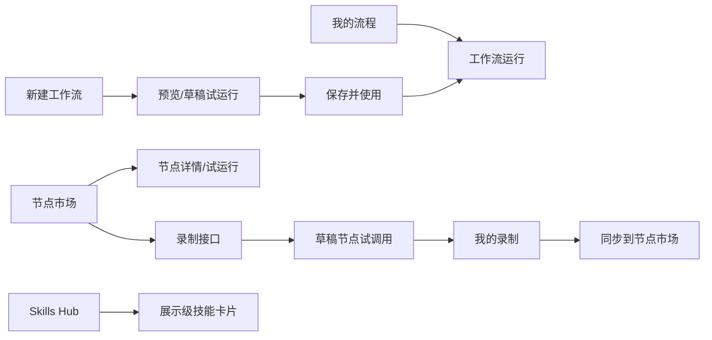

# 信息架构

## 1. 一级导航

| 导航 | 路由 | 定位 |
|---|---|---|
| 我的流程 | `#/workflows` | 已保存 workflow 列表与复用入口 |
| 节点市场 | `#/nodes` | 已同步公共节点、平台分组和我的录制 |
| Skills Hub | `#/skills` | 展示级 AI 技能入口 |
| 录制接口 | `#/nodes/record` | 三步式节点录制向导 |
| 新建工作流 | `#/workflows/new` | 自然语言生成 workflow |

## 2. 页面关系



## 3. 页面承接原则

- 工作流生成结果、草稿试运行、保存后运行共用节点卡片表达。
- SOP1 专属表格和邮件草稿面板仅保留 legacy SOP1 入口。
- 节点录制完成后先进入“我的录制”，而不是直接进入公共市场。
- 节点市场首页先看平台，再点平台看节点。
- Skills Hub 与节点市场平级，但当前不影响执行链路。

## 4. 当前主流程

### 4.1 录制节点

```text
录制接口
  -> Step 1 描述节点
  -> Step 2 打开 MCP 浏览器并操作业务系统
  -> Step 3 生成 NodeDefinition 草稿
  -> 草稿试调用
  -> 注册到我的录制
  -> 按需同步到节点市场
```

### 4.2 新建工作流

```text
新建工作流
  -> 输入自然语言需求
  -> LLM 生成 YAML
  -> 后端强校验
  -> 节点卡片预览
  -> 草稿试运行
  -> 保存并使用
  -> 我的流程 / 工作流运行
```

## 5. 页面状态

| 页面 | 关键状态 |
|---|---|
| 新建工作流 | idle、generating、generated、validation_failed、trial_running |
| 预览/运行 | pending、running、success、warning、error、skipped |
| 录制接口 | describing、recording、captured、extracting、draft_ready、trial_running、registered |
| 节点市场 | loading、empty、platform_selected、node_inspecting、trial_running |
| 鉴权 | unknown、login_required、browser_opened、saved、valid |
