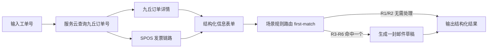

# 工作流 PRD

## 1. 范围

覆盖：

- 我的流程列表
- 新建工作流
- 工作流预览
- 草稿试运行
- 保存并使用
- 已保存工作流运行
- 轻量“让 AI 改一下”

不覆盖：

- 拖拽式画布编辑
- 复杂 DAG 编辑
- 版本管理
- 工作流发布/分享/市场
- 多人协作

---

## 2. 用户故事

### US-WF-1 首次创建

业务人员输入自然语言，例如：

```text
输入工单号后，去服务云查九丘订单号，再到九丘查订单状态，最后到 SPOS 查发票信息；
如果发现订单已完成但没有发票，自动发邮件给指定收件人。
```

系统输出一份可预览、可校验、可试运行、可保存的 workflow。

### US-WF-2 复用

业务人员在“我的流程”中找到已保存 workflow，输入参数后一键运行。

### US-WF-3 修改

业务人员基于当前 YAML 和增量指令让 LLM 生成新版本，复用同一套校验、预览和试运行流程。

---

## 3. 我的流程

入口：`#/workflows`

功能：

- 展示已保存 workflow 卡片。
- 卡片展示名称、描述、运行次数、上次运行时间和收藏状态。
- 卡片操作包括运行、编辑、复制、删除、收藏。
- 列表不展示假执行示例；所有可运行 workflow 必须有真实 YAML 或真实内置入口。

验收：

- 保存后的 workflow 出现在列表。
- 点击运行进入通用运行页或 SOP1 legacy 页面。
- 删除/编辑不影响其他 workflow。

---

## 4. 新建工作流

入口：`#/workflows/new`

功能：

- 大输入框承载用户自然语言需求。
- 展示当前可用节点摘要，至少包含节点名、type、主要输入输出。
- 支持从节点市场带 `hint` 进入新建页。
- 点击“生成工作流”调用真实 LLM provider。
- 生成过程中展示流式 YAML 或生成状态。
- LLM 未配置或调用失败时展示明确错误，不降级为 mock。

LLM 输出规则：

- 只输出 YAML 正文，不输出 Markdown 代码块。
- 顶层只允许 `id/name/description/inputs/nodes/outputs`。
- 不允许 `workflow:` 包裹层、`config`、`output` 单数字段。
- 节点类型必须来自当前可用节点。
- 节点 input name 必须匹配对应 `NodeDefinition.inputs`。
- 邮件正文、HTTP body、compose value 中的变量使用当前 runner 支持的模板。

---

## 5. 可执行 YAML 规范

基础结构：

```yaml
id: wf_direct_order_invoice_summary
name: 直客订单查询总结
description: 输入工单号，查询服务云、九丘和 SPOS 信息，并输出结构化结果。
inputs:
  - name: work_order_no
    type: string
    label: 工单号
    required: true
nodes:
  - id: sf_query
    type: serviceforce.query_customer_order_no
    inputs:
      soid: $inputs.work_order_no
  - id: jq_detail
    type: jiuqiu.query_order_detail
    dependsOn: [sf_query]
    inputs:
      order_no: $sf_query.jiuqiu_order_no
  - id: spos_info
    type: spos.query_b2c_order
    dependsOn: [sf_query]
    inputs:
      platform_order_code: $sf_query.jiuqiu_order_no
  - id: order_form
    type: data.compose
    dependsOn: [jq_detail, spos_info]
    inputs:
      value:
        work_order_no: $inputs.work_order_no
        jiuqiu_order_no: $sf_query.jiuqiu_order_no
        order_status: $jq_detail.order_status
        service_products: $jq_detail.service_products
        order_items: $spos_info.order_items
outputs:
  order_form: $order_form.value
```

依赖规则：

- 未写 `dependsOn` 时，默认按 nodes 顺序线性执行。
- 写了 `dependsOn` 后，按依赖分层，同一层可并行执行。
- 不支持循环依赖。

---

## 6. 预览页

入口：LLM 生成完成后。

功能：

- 顶部展示 workflow 名称、描述、校验状态。
- 默认展示节点卡片视图。
- 支持切换 YAML 源码。
- 支持“让 AI 改一下”。
- 支持“试运行”和“保存并使用”。

卡片展示：

- 节点名称和类型。
- 所在执行阶段。
- 依赖关系。
- 输入来源摘要，如“来自 sf_query.jiuqiu_order_no”。
- 输出字段摘要。
- 校验错误或 warning。

卡片详情：

- 完整 node inputs。
- 试运行 resolved inputs。
- 节点 outputs。
- 日志摘要。
- skipped / error 原因。

---

## 7. 草稿试运行

目标：未保存 workflow 也能验证是否可执行。

功能：

- 根据 `workflow.inputs` 动态渲染输入表单。
- 点击试运行后调用草稿运行接口。
- 运行状态直接回填当前节点卡片。
- 页面级区域展示最终 outputs、命中规则、邮件草稿摘要。
- 运行失败时定位到具体节点和错误类型。

错误类型：

- workflow schema 校验失败。
- 未知节点类型。
- 节点输入字段不存在。
- 引用不存在的上游输出。
- 鉴权失效 `AUTH_REQUIRED`。
- 输出映射失败 `DATA_NOT_FOUND`。
- 业务接口失败。

---

## 8. 保存并使用

规则：

- 只有后端强校验通过的 workflow 才允许保存。
- 保存写入 `data/workflows/{id}.yaml` 和 meta。
- 保存后进入普通运行页或回到我的流程。
- 普通运行页复用节点卡片，不默认套 SOP1 StepCard。

---

## 9. 运行页

入口：

- 我的流程卡片。
- 保存并使用。
- 预览页试运行后保存。

功能：

- 根据 workflow inputs 渲染输入表单。
- 节点卡片展示阶段、状态、输入输出和错误。
- 最终 outputs 展示结构化 JSON 或可读摘要。
- 保留最近运行记录和日志快照。

SOP1 legacy：

- `sop1-direct-order-invoice` 等 legacy id 可继续使用 SOP1 专属表格和邮件草稿面板。
- 普通 workflow 不默认展示 SOP1 专属区域。

---

## 10. 通用节点能力

### 10.1 data.compose

职责：把多源节点输出组装成稳定结构化中间表单。

边界：

- 支持对象、数组、字符串模板和 `$inputs/$node` 引用。
- 不支持 JS、SQL、map/filter/reduce、复杂聚合。

### 10.2 rules.evaluate

职责：对 facts 执行简单表达式。

第一版支持：

- `==`
- `!=`
- `&&`
- `||`
- `empty()`
- `notEmpty()`

### 10.3 rules.first_match

职责：按优先级匹配第一条规则，解决 SOP1 R1-R6 互斥场景。

输出：

- `matched`
- `rule_id`
- `action`
- `reason`
- `evaluated`

### 10.4 mail.draft

职责：生成邮件草稿，不自动发送。

规则：

- 可由 `when` 或 `rules.first_match` 控制是否生成。
- 正文必须使用 runner 支持的模板表达式。

---

## 11. SOP1 验收样例

SOP1 不写成业务特判，而是作为通用能力组合验收：



验收关注：

- 服务云查询后，九丘和 SPOS 可并行。
- 结构化表单汇总多源数据。
- 规则路由最多命中一个后续动作。
- 邮件草稿只在需要时生成。

---

## 12. 验收标准

- 输入自然语言能生成可执行 YAML。
- YAML 通过 schema、节点存在性、字段引用和模板白名单校验。
- 预览页默认展示节点卡片。
- 草稿试运行不需要先保存。
- 节点运行状态、resolved inputs、outputs、错误能回填卡片。
- 保存后的普通运行页与预览页使用同一表达体系。
- SOP1 真实 case 能通过通用节点组合表达。
- 依赖缺失时明确失败，不伪造成功。
