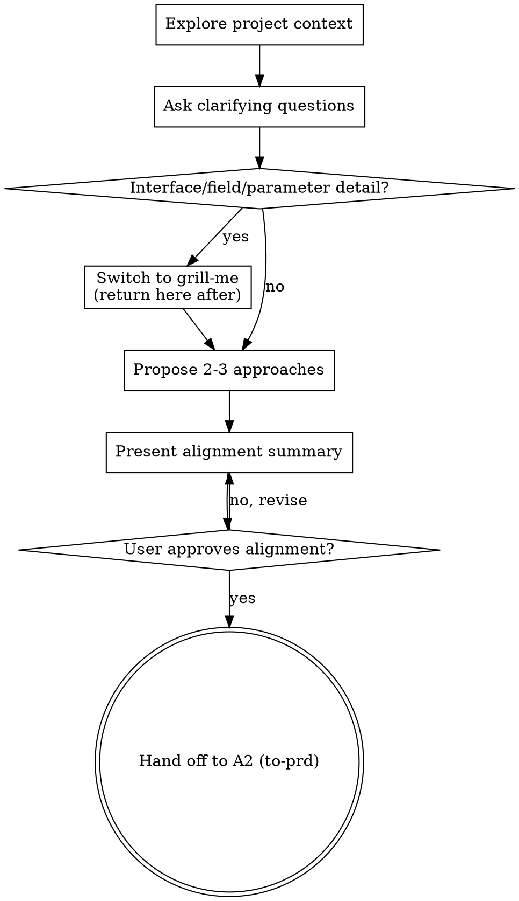

# Brainstorming Ideas Into Designs

Help turn ideas into fully formed designs and specs through natural collaborative dialogue.

Start by understanding the current project context, then ask questions one at a time to refine the idea. Once you understand what you're building, present the design and get user approval.

<HARD-GATE>
Do NOT advance to A2 (`to-prd`), write any `prd.md`, scaffold any directories, or take any implementation action until the user has explicitly approved the alignment summary. This is the first of S1's two hard gates: requirement not aligned ⇒ no `prd.md`. Applies to EVERY need regardless of perceived simplicity.
</HARD-GATE>

## Anti-Pattern: "This Is Too Simple To Need A Design"

Every project goes through this process. A todo list, a single-function utility, a config change — all of them. "Simple" projects are where unexamined assumptions cause the most wasted work. The design can be short (a few sentences for truly simple projects), but you MUST present it and get approval.

## Checklist (S1 node A1)

Complete in order:

1. **Explore project context** — read `spec/INDEX.md`, `spec/README.md`, and any existing `spec/needs/*/prd.md` to understand vocabulary and adjacent needs; check recent commits if useful
2. **Surface scope sizing** — if the request describes multiple independent subsystems, flag it (see "Working in existing codebases" below); each subsystem becomes its own need
3. **Ask clarifying questions** — one at a time; cover purpose, constraints, success criteria, what is NOT in scope
4. **If interface / field / parameter details surface** — switch to `grill-me` for that branch, then return here for the rest
5. **Propose 2-3 approaches** at requirement level (NOT technical) — with trade-offs and your recommendation
6. **Present alignment summary** — a short structured recap (problem / proposed solution / scope / out-of-scope / success criteria); get user approval
7. **Confirm hand-off to A2** — once approved, tell the user the next step is `to-prd` (which will write `spec/needs/<need-name>/prd.md`)

## Process Flow

**The terminal state is hand-off to A2 (`to-prd`), NOT directly to implementation.** Do NOT invoke `writing-plans`, `tdd`, or any other implementation skill from here. A2 produces the `prd.md`; A3 (`writing-plans`) consumes the `prd.md` to produce `design.md`. The boundary is strict.

## The Process

**Understanding the idea:**

- Check out the current project state first (files, docs, recent commits)
- Before asking detailed questions, assess scope: if the request describes multiple independent subsystems (e.g., "build a platform with chat, file storage, billing, and analytics"), flag this immediately. Don't spend questions refining details of a project that needs to be decomposed first.
- If the project is too large for a single spec, help the user decompose into sub-projects: what are the independent pieces, how do they relate, what order should they be built? Then brainstorm the first sub-project through the normal design flow. Each sub-project gets its own spec → plan → implementation cycle.
- For appropriately-scoped projects, ask questions one at a time to refine the idea
- Prefer multiple choice questions when possible, but open-ended is fine too
- Only one question per message - if a topic needs more exploration, break it into multiple questions
- Focus on understanding: purpose, constraints, success criteria

**Exploring approaches:**

- Propose 2-3 different approaches with trade-offs
- Present options conversationally with your recommendation and reasoning
- Lead with your recommended option and explain why

**Presenting the design:**

- Once you believe you understand what you're building, present the design
- Scale each section to its complexity: a few sentences if straightforward, up to 200-300 words if nuanced
- Ask after each section whether it looks right so far
- Cover: architecture, components, data flow, error handling, testing
- Be ready to go back and clarify if something doesn't make sense

**Design for isolation and clarity:**

- Break the system into smaller units that each have one clear purpose, communicate through well-defined interfaces, and can be understood and tested independently
- For each unit, you should be able to answer: what does it do, how do you use it, and what does it depend on?
- Can someone understand what a unit does without reading its internals? Can you change the internals without breaking consumers? If not, the boundaries need work.
- Smaller, well-bounded units are also easier for you to work with - you reason better about code you can hold in context at once, and your edits are more reliable when files are focused. When a file grows large, that's often a signal that it's doing too much.

**Working in existing codebases:**

- Explore the current structure before proposing changes. Follow existing patterns.
- Where existing code has problems that affect the work (e.g., a file that's grown too large, unclear boundaries, tangled responsibilities), include targeted improvements as part of the design - the way a good developer improves code they're working in.
- Don't propose unrelated refactoring. Stay focused on what serves the current goal.

## After Alignment

**Alignment summary (in conversation only — do NOT write a file):**

- Problem (from user's perspective)
- Proposed solution (at requirement level, not technical)
- In scope / Out of scope
- Success criteria
- Open questions (if any) — must be empty before the hard gate passes

**Quick self-check before declaring alignment:**

1. **Placeholder scan:** Any "TBD" or vague success criteria? Sharpen them.
2. **Scope check:** Is this a single need, or does it need decomposition into multiple needs?
3. **Ambiguity check:** Could any requirement be interpreted two ways? Pick one explicitly.

**User approval gate:**

Present the alignment summary. Ask:

> "Does this capture what you want? If yes, the next step is `to-prd` (A2), which will write `spec/needs/<need-name>/prd.md`. If anything is off, point me at it and I'll re-align."

Wait for explicit approval. If the user requests changes, iterate. Do NOT advance to A2 until approved (HARD-GATE above).

**Hand-off to A2:**

Once approved, recommend `to-prd` as the next step. Do NOT invoke `writing-plans`, `tdd`, or any other skill. The strict chain is: A1 (brainstorming) → A2 (to-prd) → A3 (writing-plans) → A4 (to-issues) → A5 (tdd) → A6 (verification-before-completion).

## Key Principles

- **One question at a time** - Don't overwhelm with multiple questions
- **Multiple choice preferred** - Easier to answer than open-ended when possible
- **YAGNI ruthlessly** - Remove unnecessary features from all designs
- **Explore alternatives** - Always propose 2-3 approaches before settling
- **Incremental validation** - Present design, get approval before moving on
- **Be flexible** - Go back and clarify when something doesn't make sense
